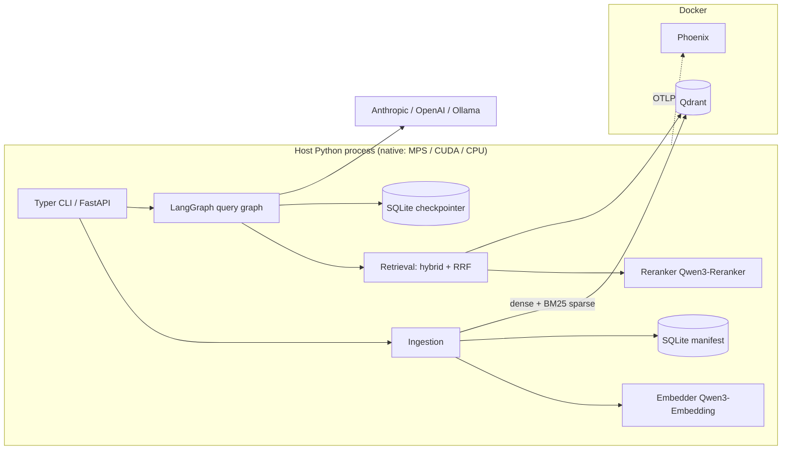

# PLAN — Local-folder RAG (LangGraph + Qdrant + Phoenix)

Source of truth for requirements: `SPEC.md`. This file covers architecture, module layout, and the phase checklist.
Status, decisions, and open questions go in `PROGRESS.md`.

## Architecture



- Models (embedder, reranker) run natively in Python, loaded once per process; only Qdrant and Phoenix run in Docker
  (Docker on macOS has no MPS access).
- Device auto-detect: cuda > mps > cpu; float16 on MPS; no flash_attention_2 on MPS.
- Ingestion: discover → hash → manifest diff → Docling parse (fallback PyMuPDF/plain) → structure-aware
  parent/child chunks → optional contextualization (Haiku, Batches + prompt caching) → dense + BM25 → Qdrant upsert.
- Query graph: analyze_query → rewrite_query → retrieve → rerank (+parent expansion, budget) → grade_documents
  (↺ rewrite, max 2) → generate → check_answer (↺ regenerate once) → respond. SQLite checkpointer keyed by thread_id.
- Routing LLM outputs use native JSON-schema structured outputs (no forced tool_choice; no non-default sampling
  params on Sonnet 5.5). Thinking blocks never shared across models.

## Module layout

```
src/rag/
  config.py            settings (pydantic-settings: init > env > .env > config.yaml), hardware profiles
  cli.py               typer: config, doctor, ingest, search, ask, chat, eval, compare
  telemetry.py         Phoenix/OTel setup, OpenInference span helpers
  devices.py           device/dtype detection
  embeddings.py        Qwen3 dense embedder, BM25 sparse embedder, token counter
  factory.py           builds components from settings; models cached once per process
  ingestion/           models, discovery, manifest (+parent docstore), parsing, chunking, contextualize, pipeline
  retrieval/           types, qdrant_index (write), qdrant_search (hybrid read), fusion (RRF), filters, rerank,
                       context (parent expansion + budget), retriever (orchestration)
  llm/                 LLM protocol + native adapters (Anthropic, OpenAI Responses, Ollama chat), schema helper
  prompts/             versioned prompts (analyze, rewrite, grade, generate, check, common delimiters)
  graph/               state.py, nodes.py, edges.py, citations.py, build.py (graph, checkpointer, run_turn)
  api/                 FastAPI app (Phase 6)
src/rag/evaluation/    golden set generation, metrics, evaluators, experiment runner (CLI-importable)
eval/                  golden.jsonl, canary_facts.jsonl, REVIEW.md, results/ (gitignored reports)
scripts/               build_test_corpus.py, corpus_sources.yaml, corpus_builder/ (per-source collectors)
tests/                 unit + integration (`-m integration`), fixtures in tests/fixtures/
```

Subpackages are created in the phase that fills them (no empty stubs).

## Phase checklist

- [x] **Phase 0 — Scaffolding**: uv project, ruff/pyright/pytest, config + profiles, docker-compose (Qdrant + Phoenix),
      `.env.example`, Makefile. Check: `docker compose up -d` healthy; pytest runs; lint + types clean.
- [x] **Phase 1 — Ingestion**: discovery, SQLite manifest (incremental, idempotent), Docling + fallback, structure-aware
      chunking with parent/child, contextual enrichment flag, dense + sparse indexing. Test-first for manifest + chunker.
      Check: ingest fixtures; re-run no-op; modify one file → only it re-indexed; delete → chunks removed.
- [x] **Phase 2 — Retrieval**: hybrid + RRF, Qwen3 reranker (model-card usage), parent expansion, dedup, context budget,
      metadata filters, `rag search`. Check: hybrid beats dense-only on exact-code query; rerank p50/p95 on mac in PROGRESS.
- [x] **Test corpus** (Section 2): `scripts/build_test_corpus.py` + `scripts/corpus_builder/` (GAO: highlights only).
- [x] **Phase 3 — LangGraph pipeline**: all nodes, routing + loop caps (test-first w/ fake LLM), checkpointer, streaming,
      citations, `rag ask` / `rag chat`. One end-to-end integration test.
- [x] **Phase 4 — Phoenix tracing**: register(), manual RETRIEVER/RERANKER spans, session.id, token counts,
      resilient when Phoenix is down.
- [x] **Phase 5 — Evaluation**: golden set, Phoenix dataset, experiments + evaluators, `rag eval [--no-retrieval]`,
      `rag compare`, leaky-question flagging, results summary.
- [ ] **Phase 6 — API + hardening**: FastAPI `/ingest`, `/ask` (SSE), `/health`; timeouts; structured logging; README.
