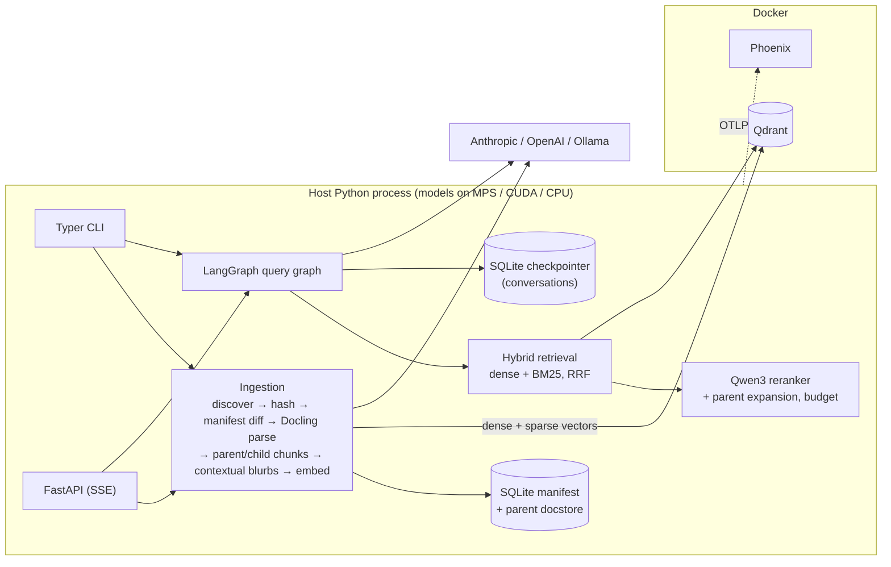
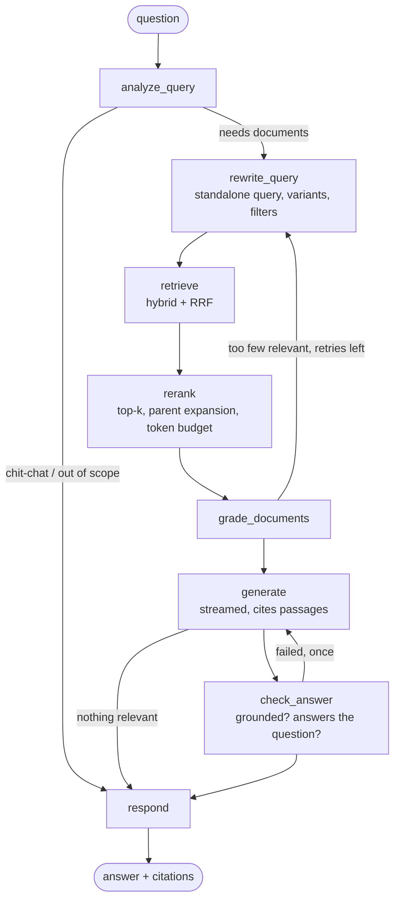

# rag — grounded, cited Q&A over a local document folder

Ask questions about your own documents (PDF, DOCX, PPTX, XLSX, HTML, Markdown, TXT) and get answers that cite
the file, page and section they come from, or an explicit "Not found in the documents." Built on a LangGraph
query pipeline, Qdrant hybrid search (dense + BM25, RRF), a Qwen3 reranker, and Arize Phoenix for tracing and
evaluation. Embedding and reranking models run natively on the host (Apple Silicon MPS, CUDA, or CPU); only
Qdrant and Phoenix run in Docker.

- [Quick start](#quick-start) · [Architecture](#architecture) · [CLI](#cli) · [HTTP API](#http-api)
- [Configuration](#configuration) · [Tracing](#tracing-phoenix) · [Evaluation](#evaluation) · [Development](#development)

## Quick start

Requirements: Python 3.12, [uv](https://docs.astral.sh/uv/), Docker, and an Anthropic API key (or OpenAI, or a
local [Ollama](https://ollama.com)). Apple Silicon macOS or Linux (Intel macs have no current torch wheels).

```bash
git clone <this repo> rag && cd rag
cp .env.example .env              # set ANTHROPIC_API_KEY; change ports if 6333/6006 are taken
make install                      # uv sync
make up                           # Qdrant + Phoenix in Docker, waits until healthy
uv run rag doctor                 # both services "ok"

mkdir -p data/docs && cp -R ~/my-documents/* data/docs/     # or set DOCS_DIR / docs_dir
uv run rag ingest                 # first run downloads the embedding/reranker and Docling layout models
uv run rag ask "What was AMD's data center segment revenue in Q3 2026?"
```

`rag ask` shows progress, streams the answer, then prints the sources (real output on the test corpus):

```
… analyzing question
… searching: What was AMD's data center segment revenue in Q3 2026?
AMD's Data Center segment revenue in Q3 2026 was a record $8.5 billion, up 97% year-over-year [1]. The 10-Q
gives the exact figure as $8,546 million for the three months ended September 26, 2026, compared with $4,341
million in the prior-year period [2]. …
… verifying answer
 #    source                          pages  section                         snippet
 [1]  AMD_8-K_filed-2026-11-03_ex9…                                          | | Q3'26 | Q3'25 | Y/Y | …
 [2]  AMD_10-Q_period-2026-09-26_f…          PART I. FINANCIAL INFORMATION   | | Three Months Ended | …
thread: 0897cad4488f48be921786c14ef53b0b
```

Without an API key you can still index (`rag ingest --no-contextualize`) and search (`rag search`).

## Architecture



Query graph (every loop has a hard cap; routing reads structured LLM outputs only):



- **Ingestion** is incremental and idempotent: a SQLite manifest tracks content hashes. Only new or changed files
  are re-indexed, and deleted files lose their chunks. Parse failures are recorded and never stop a run.
- **Chunks** follow document structure (headings, slides, sheets; tables never split mid-row). Small child chunks
  are indexed, and the larger parent section is what the LLM reads ("small-to-big").
- **Contextual retrieval**: the cheap model writes a 1–2 sentence context per chunk that is embedded with it. It
  uses Anthropic prompt caching and the Message Batches API for large runs.
- **Answers** quote only passages graded relevant. Citations `[n]` map to file + page/section + snippet. Invalid
  markers are removed, and an answer that fails verification twice is downgraded to a cautious answer that says
  what could and couldn't be verified. Document text is treated as untrusted data (prompt-injection safe).
- More detail: [`PLAN.md`](PLAN.md) (module layout) and [`PROGRESS.md`](PROGRESS.md) (decisions, measurements).

## CLI

```bash
uv run rag ingest [FOLDER]            # default: docs_dir. --force re-indexes all, --retry-failed retries parse
                                      # failures, --no-contextualize skips LLM enrichment
uv run rag search "seal kit K-2219-B" # ranked chunks with rerank/RRF scores; --mode dense|sparse, --no-rerank,
                                      # --file, --folder, --after/--before YYYY-MM-DD, --show-context
uv run rag ask "question"             # streamed, cited answer; --thread-id to continue a conversation
uv run rag chat [--thread-id ID]      # multi-turn REPL; follow-ups ("what about the second one?") work
uv run rag serve [--host --port]      # HTTP API (below)
uv run rag doctor                     # service reachability
uv run rag config                     # fully resolved settings (secrets masked)
uv run rag -v …                       # debug logging
```

Date filters use each document's date: from the file name (`report_2026-11-04.pdf`), else the first date near the
start of the text, else the file's modification time.

## HTTP API

```bash
uv run rag serve                      # http://127.0.0.1:8000, docs at /docs (OpenAPI)
LOG__FORMAT=json uv run rag serve     # one JSON log object per line
```

The server loads the models before accepting requests (~10 s). It has **no authentication** and binds to
loopback by default. Put it behind an authenticating proxy before exposing it.

### `POST /ask` — Server-Sent Events

```bash
curl -N http://127.0.0.1:8000/ask -H 'Content-Type: application/json' \
     -d '{"question": "What was Uber revenue in Q3 2026 compared with a year earlier?"}'
```

```
event: status
data: {"node": "analyze_query", "text": "analyzing question"}

event: status
data: {"node": "rewrite_query", "text": "searching: What was Uber revenue in Q3 2026 compared with Q3 2025?"}
…
event: answer_start
data: {"attempt": 1}

event: token
data: {"text": "Uber's revenue was $14,766 million"}
…
event: final
data: {"thread_id": "943beb68…", "status": "answered", "text": "Uber's revenue was $14,766 million in Q3 2026,
       compared with $13,467 million in Q3 2025, an increase of 10% [1][2]. …",
       "citations": [{"index": 1, "file_path": "/…/UBER_10-Q_period-2026-09-30_filed-2026-11-04.htm",
       "file_name": "UBER_10-Q_…", "title": "…", "page_start": null, "page_end": null,
       "section": "PART I - FINANCIAL INFORMATION > ITEM 2. MANAGEMENT'S DISCUSSION …", "snippet": "…"}, …]}
```

| event | data | meaning |
|---|---|---|
| `status` | `{node, text}` | progress: analyzing, searching (with the rewritten query), verifying |
| `node` | `{node}` | a graph node finished |
| `answer_start` | `{attempt}` | a (re)generation starts; on `attempt > 1` discard the tokens shown so far |
| `token` | `{text}` | answer text as the model streams it |
| `final` | `{thread_id, status, text, citations[]}` | the answer to display (citation markers validated); `status` is `answered`, `abstained`, `cautious`, `chitchat` or `out_of_scope` |
| `error` | `{type, message, thread_id}` | `timeout`, `llm_error` (provider failure after retries) or `internal_error` |

Every stream ends with exactly one `final` or `error` event. Idle streams get `: ping` comments every 15 s.

- **Conversations**: the response header `X-Thread-ID` (and `final.thread_id`) identifies the conversation.
  Send it back as `"thread_id"` for follow-ups. History is persisted in `.rag/checkpoints.db`.
- **Limits**: one turn at a time per thread (`409` while it is still running), at most
  `api.max_concurrent_turns` turns overall (`429`), and questions up to `api.max_question_chars` (`422`).
- **Timeouts**: every turn has an end-to-end deadline (`graph.turn_timeout_s`, default 180 s; also applies to the
  CLI). On expiry the stream ends with `error/timeout` and the turn is cancelled. If the client disconnects, the
  turn is cancelled too. Each LLM request has its own timeout and retries (`llm.request_timeout_s`,
  `llm.max_retries`).
- Every response carries `X-Request-ID` (yours, if you send one). It appears on every log line of that request.

### `POST /ingest`, `GET /ingest/{id}`

```bash
curl -s http://127.0.0.1:8000/ingest -H 'Content-Type: application/json' -d '{"path": "contracts", "force": false}'
# 202 {"id": "64f4…", "status": "running", "path": "/…/data/docs/contracts", …}
curl -s http://127.0.0.1:8000/ingest/64f4…
# {"status": "succeeded", "progress": {"parsed": 7, "indexed": 7}, "stats": {"indexed": 7, "chunks_written": 20, …}}
```

Body: `path` (relative to `docs_dir`, default `docs_dir`), `force`, `retry_failed`, `contextualize` (overrides the
config for this job). Jobs run in the background, one at a time (`409` otherwise). Paths outside `docs_dir` and
`api.ingest_roots` are rejected (`403`). Questions are still served during ingestion. They share the in-process
models with it, so expect them to be slower.

### `GET /health`

`200 {"status": "ok", "services": {"qdrant": …, "phoenix": …}, "active_turns": 0, "ingest_running": false}`, or
`503` with `"status": "degraded"` when Qdrant is unreachable. Phoenix is optional and never makes the API unhealthy.

## Configuration

Precedence (highest first): environment variables > `.env` > `config.yaml` > built-in defaults. Nested settings
use `__` in environment variables, e.g. `LLM__PROVIDER=openai`, `GRAPH__TURN_TIMEOUT_S=60`. A different YAML file can
be selected with `RAG_CONFIG_FILE`. `uv run rag config` prints the resolved values.

| setting (env var) | default | |
|---|---|---|
| `docs_dir` (`DOCS_DIR`) | `./data/docs` | folder indexed by `rag ingest` / `POST /ingest` |
| `state_dir` (`STATE_DIR`) | `./.rag` | manifest, parent docstore, conversation checkpoints |
| `hardware_profile` (`HARDWARE_PROFILE`) | `mac` | `mac`: Qwen3-Embedding-0.6B + Qwen3-Reranker-0.6B, float16, 20 rerank candidates; `gpu`: the 4B models, bfloat16, 30; `cpu`: 0.6B + bge-reranker-v2-m3, float32, 20 |
| `device` (`DEVICE`) | `auto` | cuda > mps > cpu |
| `ANTHROPIC_API_KEY`, `OPENAI_API_KEY` | – | provider keys |
| `llm.provider` | `anthropic` | `anthropic` \| `openai` \| `ollama` |
| `llm.generation_model` / `cheap_model` / `upgrade_model` | per provider | Anthropic: `claude-sonnet-5-5` / `claude-haiku-5-5` / `claude-opus-5-5` |
| `llm.tasks.<node>` | see `config.py` | model role, effort, max tokens, thinking per node (`analyze`, `rewrite`, `grade`, `check`, `generate`, eval tasks) |
| `llm.request_timeout_s`, `llm.max_retries` | 120, 3 | per LLM request (SDK backoff on 429/5xx) |
| `llm.ollama_base_url`, `llm.openai_base_url` | `http://localhost:11434`, – | |
| `embedding.model`, `embedding.batch_size` | profile | query instruction prefix per the Qwen3 model card |
| `reranker.enabled`, `reranker.model`, `reranker.candidates`, `reranker.top_k` | true, profile, profile, 6 | |
| `retrieval.mode` | `hybrid` | `hybrid` \| `dense` \| `sparse` |
| `retrieval.candidates_per_ranking`, `retrieval.rrf_k` | 50, 60 | hits per ranking before fusion; RRF constant |
| `retrieval.context_token_budget` | 12000 | tokens of parent passages sent to the LLM |
| `chunking.child_target_tokens` / `child_max_tokens` / `overlap_ratio` / `parent_max_tokens` | 500 / 600 / 0.12 / 2000 | |
| `ingestion.contextualize` | true | contextual enrichment (needs an LLM) |
| `ingestion.contextualize_mode` | `auto` | `batch` (Anthropic Message Batches, 50% cheaper) \| `sync` \| `auto` (batch from 200 chunks) |
| `ingestion.pdf_ocr` | true | OCR for scanned PDFs (Docling) |
| `graph.max_rewrite_retries`, `graph.max_regenerations` | 2, 1 | loop caps |
| `graph.min_relevant_passages`, `graph.max_query_variants`, `graph.history_turns` | 2, 4, 6 | |
| `graph.turn_timeout_s` | 180 | end-to-end deadline per question (CLI + API) |
| `api.host`, `api.port` | `127.0.0.1`, 8000 | |
| `api.max_concurrent_turns`, `api.max_question_chars` | 4, 4000 | |
| `api.ingest_roots` | `[]` | extra folders `POST /ingest` may index |
| `log.level`, `log.format` | `INFO`, `text` | `json` = one object per line with `request_id` / `thread_id` / `job_id` fields |
| `qdrant.url`, `qdrant.collection`, `qdrant.api_key` | `http://localhost:6333`, `rag_chunks`, – | |
| `phoenix.enabled`, `phoenix.collector_endpoint`, `phoenix.project_name` | true, `http://localhost:6006`, `rag` | |
| `phoenix.api_key`, `phoenix.user_id` | –, OS user | API key only if Phoenix auth is enabled |

Docker host ports: `QDRANT_HTTP_PORT`, `QDRANT_GRPC_PORT`, `PHOENIX_PORT`, `PHOENIX_GRPC_PORT` in `.env`. If you
change them, update `QDRANT__URL` / `PHOENIX__COLLECTOR_ENDPOINT` to match.

**Providers.** OpenAI: `LLM__PROVIDER=openai` + `OPENAI_API_KEY`. Ollama: `LLM__PROVIDER=ollama` and a pulled model
(`ollama pull qwen3:8b`). Small local models answer noticeably worse. Contextual enrichment works with all three,
but batching and prompt caching are Anthropic-only.

## Tracing (Phoenix)

`make up` starts Phoenix at http://localhost:6006 (or your `PHOENIX_PORT`). Traces are automatic for `ingest`,
`search`, `ask`, `chat` and the API: every graph node with its latency, retriever and reranker spans with the
documents and scores, and LLM calls with token counts. API turns are nested under an HTTP span (`POST /ask`).
Conversation turns are grouped by session (= thread id). If Phoenix is down, tracing is skipped with one warning
and nothing slows down. Disable it with `PHOENIX__ENABLED=false`.

## Evaluation

The evaluation runs on a test corpus of documents published after the models' training cutoff, so correct
answers can only come from retrieval.

```bash
uv run python scripts/build_test_corpus.py   # SEC filings, arXiv, GAO, Federal Register, release notes, canaries
export DOCS_DIR=data/test_corpus QDRANT__COLLECTION=test_corpus STATE_DIR=.rag/test_corpus
uv run rag ingest
uv run rag golden generate                   # eval/golden.jsonl: LLM-written, auto-verified Q&A (review it!)
uv run rag golden upload                     # Phoenix dataset (content-addressed: edits create a new version)
uv run rag eval --no-retrieval               # closed-book baseline; flags "leaky" questions
uv run rag eval                              # full pipeline as a Phoenix experiment (per-example scores in the UI)
uv run rag compare --variant "ctx:qdrant.collection=test_corpus_ctx,state_dir=.rag/test_corpus_ctx" \
                   --variant "plain:qdrant.collection=test_corpus,state_dir=.rag/test_corpus"
```

- Evaluators: retrieval hit@k, MRR and NDCG@k against the gold documents, plus LLM judges (cheap model) for
  correctness vs the reference, faithfulness, answer relevance and citation support. Abstention on unanswerable
  questions, latency and cost per query are also reported.
- Variants are `name:dotted.setting=value,…` overrides of any setting, e.g. `reranker.enabled=false`,
  `reranker.top_k=3`, `retrieval.mode=dense`. Each variant becomes its own Phoenix experiment, so results are
  comparable side by side.
- Reports are also written to `eval/results/`. Results so far are in `PROGRESS.md`. The golden set is awaiting
  human review (`eval/REVIEW.md`).
- gao.gov blocks scripted downloads: save GAO report PDFs by hand into `data/test_corpus/gao/` as
  `gao-XX-XXXXXX.pdf`, then re-run the builder. Sources and licenses go to `data/test_corpus/SOURCES.md`.

## Development

```bash
make check               # ruff + ruff format --check + pyright (strict) + unit tests (~7 s, no services)
make test-integration    # needs Qdrant, Phoenix, models and an API key
make fmt                 # format + autofix
```

Layout: `src/rag/{ingestion,retrieval,graph,llm,prompts,api,evaluation}`, `tests/` (unit; `-m integration` for
the rest), `scripts/` (test-corpus builder, retrieval benchmark), `eval/` (golden set, canary facts).

Troubleshooting:
- Port already in use: change the ports in `.env` (see Configuration).
- First `ingest`/`ask` is slow: models are downloading. `HF_TOKEN` in `.env` speeds up Hugging Face downloads.
- Ingestion hangs on macOS: keep `TOKENIZERS_PARALLELISM=false` (set by default; avoids a tokenizer/Docling
  deadlock).
- Phoenix returns 401: Phoenix ≥ 22 enables auth by default in containers. The compose file turns it off for
  loopback use (see `docker-compose.yml` to enable it).
